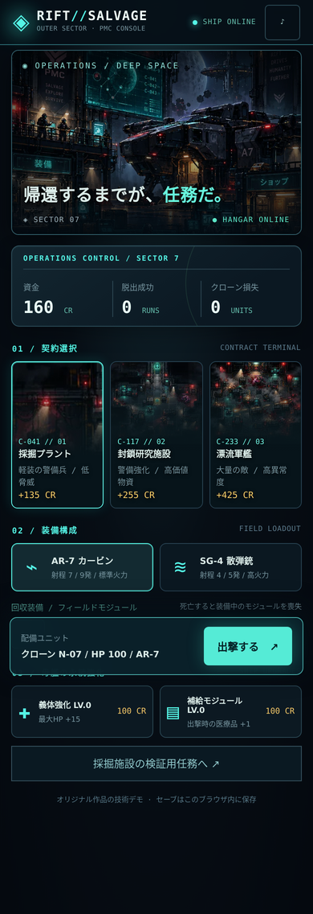
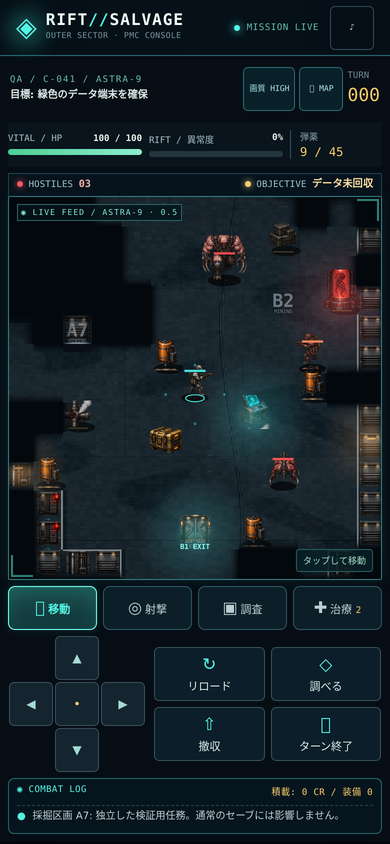
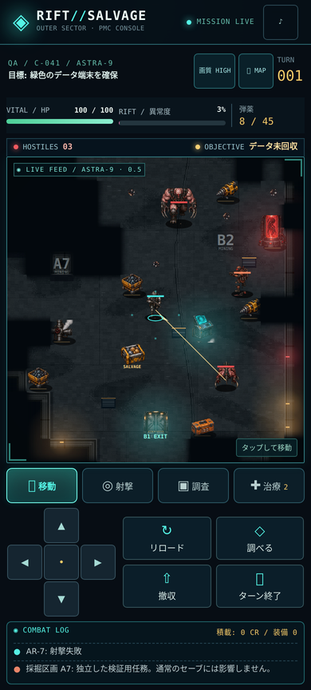
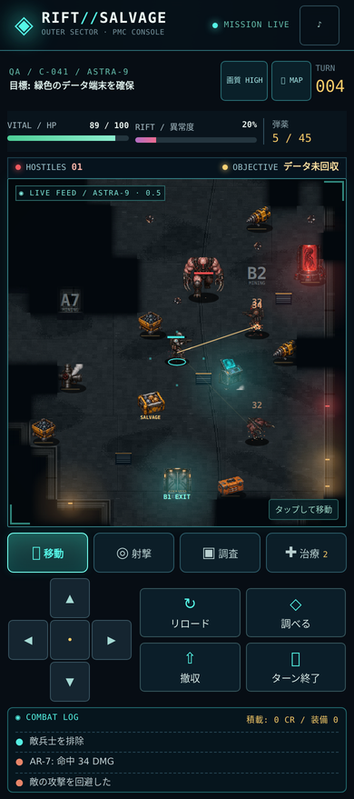
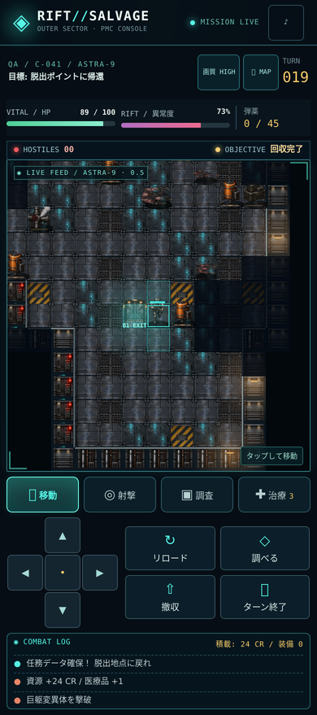

# Mining visual rebuild — implementation and evidence

Baseline: `b052277394cffef31788aa9774e8c64c08e19bcb` (v0.4). This report distinguishes automated evidence from device acceptance. The original specification remains the acceptance target, not a claim that every visual/detail goal has been met.

## Implemented

- Canvas 2D passes: cached ground, structural faces, props, depth-sorted units, world effects, fog, tactical indicators, HTML controls. One grid-to-screen transform. Camera/animation never advance turns or roll combat RNG.
- Original generated source atlases, deterministic export script and runtime PNGs under `assets/v1/`. Four cardinal facings per actor. Idle, articulated walk, recoil/attack, hit and death frames. Source artwork is not a gameplay screenshot and is never used as a full-scene layer.
- Twelve floor variants, sixteen wall masks, physical crates/stacks/barrels, terminal, cache, exit gate, containment tank and pipe outlet. Cyan terminal light, warm wall lights, red tank, timed muzzle flashes/tracers/sparks/blood and drifting steam. No runtime image generation or per-tile/per-frame gradient construction.
- Optional authored 35×35 mining mission at `?showcase=1`; normal procedural missions are retained. The sandbox uses a separate **sessionStorage** key and never writes the campaign's `rift-salvage-save-v1` localStorage. Its rewards are sandbox-only. Enter from the ship's “採掘施設の検証用任務へ” button; return with “通常の母艦へ戻る”.
- Loader/decode/12-second timeout, visible art failure with procedural fallback, DPR caps (HIGH 2 / ECO 1.25), bounded particle budget, reduced-motion support, hidden-tab animation cancellation and audio suspension.
- 44px gameplay targets, portrait and landscape controls, overlay input blocking, pointer-ID tracking. Swipes in shooting mode do not shoot or move. Existing action costs, AI, collision, detection, RNG, rewards and save data are retained.
- Pages packages only HTML, manifest and five runtime atlases. Source art, test files and tooling are excluded from `_site`. No server, runtime npm build, remote scripts, telemetry, AP mechanic or framework added.

## Automated evidence

`npm test` passes 22 browser checks, plus static packaging/syntax/asset checks and a real-action showcase playthrough. The suite runs the original v0.4 HTML alongside the rebuilt version using identical saved fixtures and compares **complete game/save state**, including RNG, after valid/blocked/range shots, movement, reload/heal/wait, kill/loot/data/extraction, and death with carried equipment.

- 100 deterministic procedural seeds: all objectives, caches and exits reachable with blocking cover enabled.
- v0.4 saved mission, continuing after reload, unavailable localStorage, missing-art fallback.
- Unseen enemy changes produce identical canvas screenshots behind fog.
- Independent animation changes pixels without game-state changes; reduced motion produces stable pixels.
- 320×700, 375×812, 390×844, 430×932, 844×390: no horizontal overflow; all visible gameplay buttons at least 44px.
- Normal default showcase: all three enemy kinds killed, loot and terminal collected, extraction completed; 319 CR / 1 win in the isolated sandbox. No state injection in this playthrough.

Raw outputs: `tests/evidence/results.json`, `seed-reachability.json`, `playthrough.json`. CI uploads fresh screenshots/results in `mining-visual-evidence`.

## Performance measurement — not iPhone evidence

Linux container, AMD EPYC 9V74, headless Chromium 134.0.6998.35, CSS 390×844, deviceScaleFactor 2. Each quality ran 60 seconds of sinusoidal render-only camera movement with independently animated enemies. The container also ran regression checks during part of this sampling window.

| Requested/actual quality | Internal canvas | Median frame | p95 frame | >100ms frames |
|---|---|---|---|---|
| HIGH / high | 744×764 | 16.7ms | 16.7ms | 0 |
| ECO / balanced | 465×478 | 16.7ms | 16.7ms | 0 |

Median cadence ~59.88fps on this host. This does **not** establish iPhone rendering performance, GPU time or touch latency. Raw sample summary is in `tests/evidence/performance.json`. Run `npm run bench` for the same 2×60-second harness.

Runtime atlases total 2,231,460 bytes (~2.13 MiB), below the 8MB target. Chunk cache holds at most 49 × 480×480 RGBA canvases (~43MiB worst case), plus ~14.6MiB decoded actor/environment atlases. Real Safari memory/eviction behavior is pending.

## Actual engine screenshots

| Ship | Mining traversal |
|---|---|
|  |  |

| Firefight | Brute | Extraction |
|---|---|---|
|  |  |  |

All captures come from the live game engine. CSS-resolution WebP review copies are committed to keep review downloads smaller; CI also captures original PNGs. Baseline v0.4 captures are included. No generated concept art is presented as a test result.

## Reference comparison and remaining gaps

| Approved reference | Current implementation / gap |
|---|---|
| Dense dark metal, cyan PMC/terminal, red containment | Those materials and separated elements are present. Floor repetition remains more evident, and small-scale lighting is less detailed. |
| Large cinematic character silhouettes | Rich original 4-way sprite art replaces geometric placeholders. Low-resolution frame rigs are still simpler than fully hand-drawn animation; no claim of production-quality animation parity. |
| A7/B2/B1 composition | Authored optional map contains these markings, reachable terminal/loot/exit and physical cover. True line-of-sight can hide parts of the composition; it is not a permanently revealed promotional layout. |
| Deep layered machinery, dense smoke/reflections | Props and warm/red/cyan lighting are independent. Reflections are tile material highlights, not full dynamic reflected sprites; steam is intentionally shallow/bounded. |
| Illustrated AP display | Deliberately absent: the authoritative game has no AP mechanic. |

Open acceptance items: actual iPhone Safari full mission, safe-area/browser chrome behavior, two-thumb/multitouch ergonomics, 60-second HIGH/ECO measurements with exact iPhone/iOS/Safari versions. Linux WebKit was downloaded but cannot launch because GTK/GStreamer and related host libraries are missing; it is **not marked passed**. Frame snapshots are deterministic within the tested browser, but no cross-platform golden-pixel assertion is claimed. Movement path previews beyond immediately reachable adjacent tiles remain unimplemented. VESTA/NEREID currently share the new asset library; dedicated finished art sets are deferred.

## Safari manual smoke

Open the public HTTPS URL in Safari (not an HTML attachment preview). Confirm normal saved campaign resumes. Open the isolated showcase from the ship; deploy; use tap, D-pad and swipe; shoot all enemy types; reload/heal as needed; recover the nearby gold cache and cyan terminal; return to B1 and extract. Toggle HIGH/ECO, rotate, open/close map, background/restore Safari and resume after reload. Confirm no hidden controls, duplicate actions or altered campaign credits. Record device and frame samples via `__RIFT_TEST__.getFrameSamples()` for each 60-second run.

## Deployment status

Baseline public URL returned HTTP 200 before implementation. Updated main/Pages verification will be reported in the implementation PR after CI and deployment; this report does not mark an unobserved deployment or iPhone session as passed.
